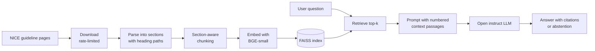

# medguide-rag
Evidence-grounded RAG assistant for NICE clinical guidelines. Section-aware chunking, FAISS retrieval and open Hugging Face models answer with citations and say "I don't know" when evidence is missing. Includes evaluation and Responsible AI notes. Decision support only, not medical advice.
# MedGuide: Evidence-Grounded RAG for NICE Clinical Guidelines


MedGuide is a retrieval-augmented generation (RAG) system that answers clinical guideline questions **with citations**, and **abstains** when the retrieved evidence does not support an answer. It is built on public NICE guidelines using open-source models from Hugging Face.

> **Disclaimer:** MedGuide is a research and portfolio project. It is decision-support tooling, **not medical advice**, and must not be used for diagnosis or treatment. It uses no patient data.

---

## Table of Contents

- [Motivation](#motivation)
- [Key Features](#key-features)
- [Architecture](#architecture)
- [Project Structure](#project-structure)
- [Getting Started](#getting-started)
- [Evaluation Methodology](#evaluation-methodology)
- [Results](#results)
- [Responsible AI](#responsible-ai)
- [Limitations](#limitations)
- [Roadmap](#roadmap)
- [Data and Licensing](#data-and-licensing)
- [Author](#author)

---

## Motivation

Language models can produce fluent but unsupported answers, which is an unacceptable failure mode in healthcare. MedGuide treats this as an engineering and measurement problem: every answer must be grounded in retrieved source text, shown with its citation, and the system's behaviour must be evaluated rather than assumed.

## Key Features

| Area | Approach |
|---|---|
| **Section-aware chunking** | Chunks never cross section boundaries and carry their heading path, so embeddings capture context. |
| **Dense retrieval** | `BAAI/bge-small-en-v1.5` embeddings with a FAISS inner-product index. |
| **Grounded generation** | An open instruct LLM answers only from numbered context passages and cites them as `[1]`, `[2]`. |
| **Abstention** | The model is instructed to reply "I don't know based on the provided guidelines." when evidence is missing. |
| **Hybrid retrieval and reranking** | BM25 + dense fusion with a cross-encoder reranker *(planned)*. |
| **Evaluation harness** | Retrieval, faithfulness and abstention metrics with ablations *(planned)*. |

## Architecture



## Project Structure

```
medguide-rag/
├── data/
│   ├── urls.txt            # guideline page URLs to ingest
│   ├── raw/                # downloaded HTML (git-ignored)
│   └── processed/          # sections, chunks, FAISS index (git-ignored)
├── src/
│   ├── download.py         # polite downloader
│   ├── parse.py            # HTML -> sections with heading paths
│   ├── chunk.py            # section-aware chunking
│   ├── index.py            # embeddings + FAISS index
│   └── ask.py              # retrieval + grounded generation
├── requirements.txt
└── README.md
```

## Getting Started

**Prerequisites:** Python 3.10+. A CPU is sufficient for the baseline. A free [Hugging Face access token](https://huggingface.co/settings/tokens) is needed only for LLM answers.

```bash
git clone https://github.com/<your-username>/medguide-rag.git
cd medguide-rag
pip install -r requirements.txt
```

1. Add guideline page URLs to `data/urls.txt`.
2. Build the pipeline:

```bash
python src/download.py   # fetch pages (1 request / 2 seconds)
python src/parse.py      # sections with heading paths
python src/chunk.py      # section-aware chunks
python src/index.py      # embeddings + FAISS index
```

3. Ask questions:

```bash
# Retrieval only (no LLM, no token needed)
python src/ask.py "How should blood pressure be measured?" --no-llm

# Full RAG answer with citations
export HF_TOKEN=hf_xxx
python src/ask.py "How should blood pressure be measured?"
```

The default generator is `meta-llama/Llama-3.1-8B-Instruct`. Model availability on the free Inference API changes, so set `HF_MODEL` to any available instruct model if needed.

## Evaluation Methodology

Evaluation is the core of this project. The plan:

- **Test set:** 50 hand-written clinician-style questions with reference passages, including unanswerable and out-of-scope questions.
- **Retrieval metrics:** Recall@k and MRR.
- **Generation metrics:** Faithfulness (are claims supported by the cited passage?) and answer relevance, using RAGAS or an LLM-as-judge with manual spot checks.
- **Abstention:** Accuracy on questions the guidelines cannot answer.
- **Ablations:**
  - Vector only vs. hybrid (BM25 + dense) vs. hybrid + reranker
  - Fixed-size vs. section-aware chunking

## Results

*Results will be added after evaluation. No figures are reported until they have been measured.*

| Configuration | Recall@5 | MRR | Faithfulness | Abstention accuracy |
|---|---|---|---|---|
| Vector only (fixed chunks) | TBD | TBD | TBD | TBD |
| Vector only (section-aware) | TBD | TBD | TBD | TBD |
| Hybrid (BM25 + dense) | TBD | TBD | TBD | TBD |
| Hybrid + cross-encoder reranker | TBD | TBD | TBD | TBD |

## Responsible AI

- **Decision support, not diagnosis.** The system is designed to surface evidence for a human to review, never to replace clinical judgement.
- **Traceability.** Every answer cites numbered source passages so claims can be checked against the original guideline.
- **Abstention by design.** The system is prompted and evaluated to decline rather than guess.
- **No patient data.** Only public guideline text is used.
- **Failure analysis.** Failure cases and error categories will be documented alongside the results.

## Limitations

- Guidelines are updated over time, so the indexed text may be out of date. Always check the current guideline.
- Retrieval can miss relevant passages, and the LLM can still misread or over-generalise context.
- Tables, figures and algorithms in guidelines may not be captured by text-only parsing.
- The evaluation set is small and written by one author, so results indicate trends rather than clinical reliability.
- Open models on free inference tiers can be rate-limited or change availability.

## Roadmap

- [x] Downloader, parser and section-aware chunking
- [x] Baseline dense retrieval with FAISS and grounded generation
- [ ] BM25 hybrid retrieval and cross-encoder reranking
- [ ] 50-question evaluation set and metrics
- [ ] Ablation study and failure analysis
- [ ] Citation verification and abstention testing
- [ ] Gradio demo on Hugging Face Spaces
- [ ] Optional: containerised deployment on Azure Container Apps

## Data and Licensing

### Code License
The code in this repository is released under the [MIT License](LICENSE). Feel free to adapt, modify, and build upon this project.

### Data & Copyright Notice
* **Guideline Content:** All clinical guideline content is owned by the **National Institute for Health and Care Excellence (NICE)** and is subject to [NICE's terms and conditions](https://www.nice.org.uk/terms-and-conditions) for content reuse.
* **Non-Commercial Use:** Guideline text is processed solely for personal research and demonstration purposes. 
* **Data Privacy:** Raw downloaded text and processed vector index files are excluded via `.gitignore` and are not redistributed in this repository. Users must run the scraping script locally to generate context files.

## Author
**[Sonia]** – MSc in Artificial Intelligence
Interested in applied AI, NLP, and healthcare engineering.
[LinkedIn](https://linkedin.com) • [GitHub](https://github.com)
